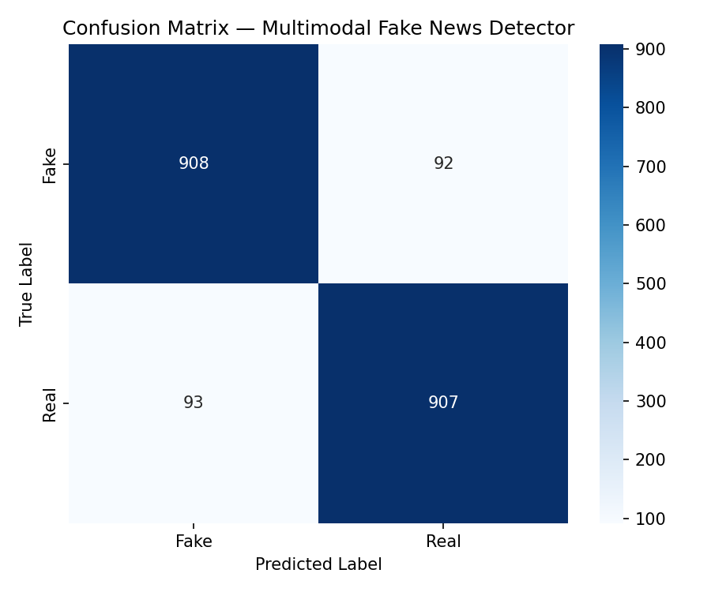
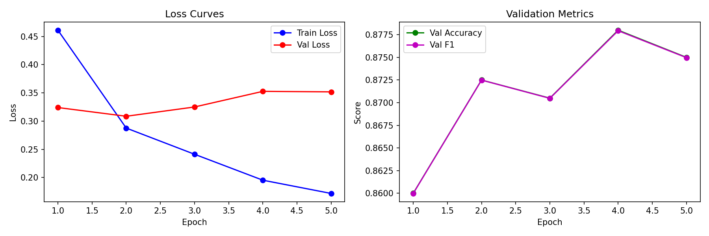

# Multimodal Fake News Detection

A deep learning-based multimodal system for detecting fake news by jointly analyzing **text, images, and user comments**.

## Overview

Traditional fake news detection systems often rely primarily on textual information. This project combines multiple modalities to capture complementary signals from news content.

The system uses:
- **RoBERTa-base** for news text
- **RoBERTa-base** for user comments
- **ResNet-50** for image features
- Feature fusion followed by a fully connected classifier

### Architecture

```text
News Text ──► RoBERTa ──► 768-D ─┐
                                  │
Comments ───► RoBERTa ──► 768-D ──┼──► Feature Fusion
                                  │       (3584-D)
Image ──────► ResNet-50 ► 2048-D ─┘            │
                                               ▼
                                      Fully Connected Layers
                                               │
                                         Fake / Real
```

## Performance

The model was evaluated on a held-out test set of 2,000 samples.

| Metric | Score |
|---|---:|
| **Accuracy** | **90.75%** |
| **F1-Score** | **0.91** |

### Dataset

The project uses the **Fakeddit** multimodal dataset.

| Split | Samples |
|---|---:|
| Training | 10,000 |
| Validation | 2,000 |
| Test | 2,000 |

The training subset contains 5,000 Fake and 5,000 Real samples.

## Technologies

**Languages & Frameworks**
- Python
- PyTorch
- Flask

**Deep Learning**
- RoBERTa
- ResNet-50
- Multimodal Feature Fusion

**Tools**
- Google Colab
- NVIDIA Tesla T4 GPU

## Project Structure

```text
multimodal-fake-news-detection/
│
├── app.py
├── train.py
├── evaluate.py
├── predict.py
├── config.py
├── requirements.txt
│
├── models/
│   └── multimodal_model.py
│
├── utils/
│   ├── dataset.py
│   └── download_data.py
│
├── templates/
│   └── index.html
│
└── outputs/
    ├── confusion_matrix.png
    ├── training_curves.png
    └── test_report.txt
```

## Installation

```bash
git clone https://github.com/Monalisha2961/multimodal-fake-news-detection.git
cd multimodal-fake-news-detection

python -m venv venv
venv\Scripts\activate

pip install -r requirements.txt
```

## Usage

### Train

```bash
python train.py
```

### Evaluate

```bash
python evaluate.py
```

### Run the Web Application

```bash
python app.py
```

## Results

### Confusion Matrix



### Training Curves



## Research

This project explores multimodal fake news detection through **text-image-comment fusion using deep learning**.

## Author

**Monalisha Swain**  
B.Tech — Computer Science & Engineering  
Siksha 'O' Anusandhan (SOA) University

---

⭐ If you find this project useful, consider giving the repository a star.
